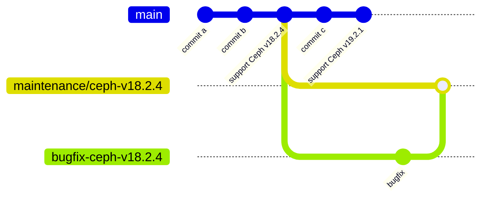

# ceph

1. Check the [release page](https://docs.ceph.com/en/latest/releases/).
2. Check the [build ceph](https://docs.ceph.com/en/latest/install/build-ceph/) document and [README.md](https://github.com/ceph/ceph/blob/main/README.md).
   1. If other instructions are needed for `ceph/build.sh`, add the instructions.
   2. If there are ceph runtime packages or required tool changes, update Dockerfile.
3. Update `BRANCH` and `TAG` files.

## Create a patched image from the specific version

Occasionally, you may want to create an image patched against a past version of Ceph. A typical use case is when you've updated Ceph's version to use as a Rook base image, but that version contains a critical bug that causes problems when running Ceph daemons like OSDs.

In this situation, you might encounter a security issue in the version currently used by Ceph daemons and wish to apply a patch. The procedure described in this section should be useful in such cases.

When you want to create a new image with patches to the specific version of Ceph,
follow these steps.

1. Create a branch with the name `maintenance/ceph-vX.Y.Z` from the commit you want, and push it.
   - You must follow the branch naming convention to activate the image build and push jobs.
   - If the branch already exists, you can skip this step.
2. Create a PR to the branch `maintenance/ceph-vX.Y.Z`, and merge it.
3. Build a docker image for the branch `maintenance/ceph-vX.Y.Z` by running [`Build Ceph image for a past version`](https://github.com/cybozu/neco-containers/actions/workflows/ceph.yaml) workflow manually.

